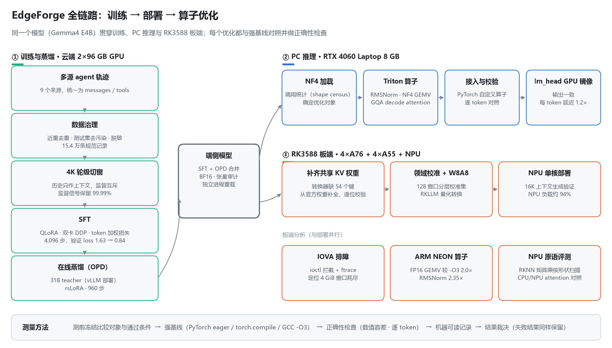
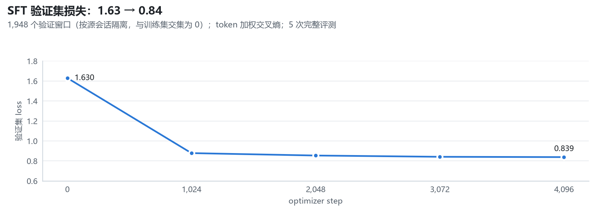
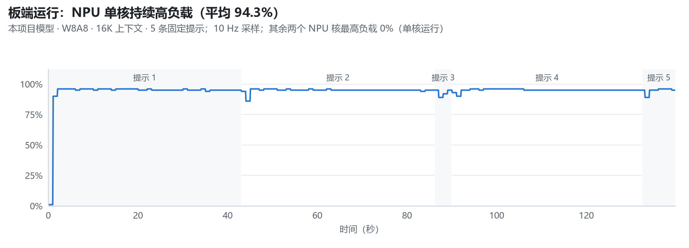
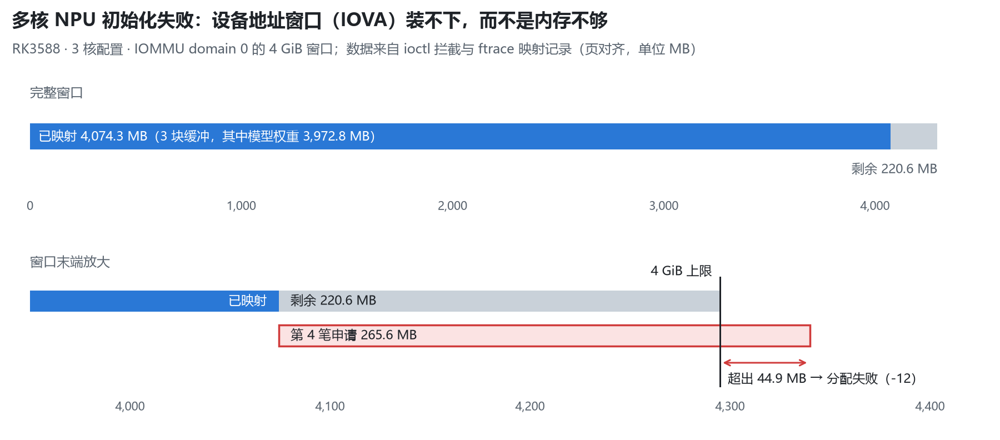
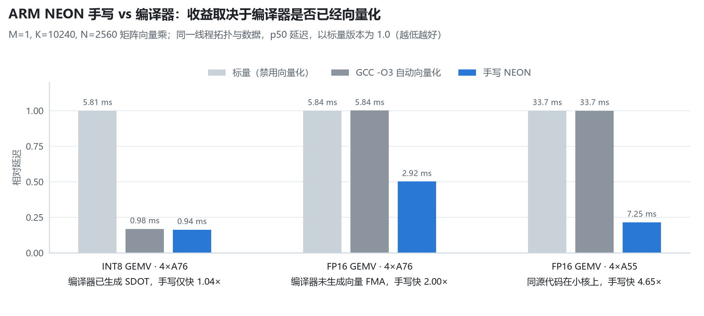
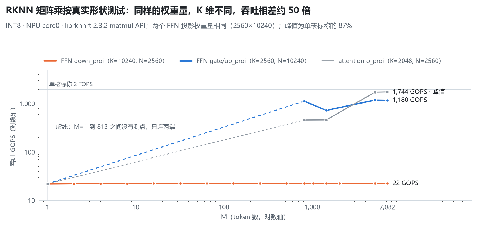
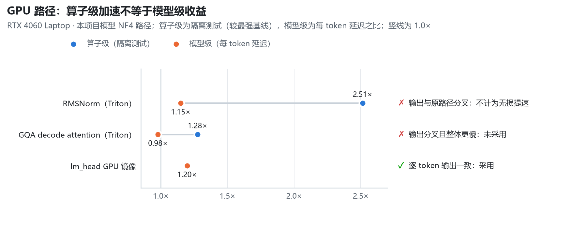

# EdgeForge：端侧大模型部署与推理性能优化

以 **Gemma4 E4B** 为对象，完成从数据治理、SFT 与在线蒸馏，到 **RK3588 NPU 部署**，以及 **GPU / ARM / NPU 算子实现与测量**的完整工程链路。

每个性能结论都与强基线（PyTorch eager、torch.compile、GCC -O3）对照，并附正确性检查和机器可读的实验记录。算子单独变快和接入模型后是否仍然有效，是分开验证的两件事。

<picture>
  <source media="(prefers-color-scheme: dark)" srcset="docs/figures/architecture_dark.png">
  
</picture>

## 核心结果

| 模块 | 结果 | 条件与基线 | 入口 |
|---|---|---|---|
| 板端部署 | RKLLM **W8A8**，RK3588 NPU 单核 **16K 上下文**运行 | 补齐 54 个共享 KV 权重键，逐位校验 2,130 个张量 | [转换代码](scripts/operator/board/) |
| 多核排障 | 定位为 **IOVA 4 GiB 窗口耗尽**（3 核缺口 44.9 MB） | ioctl 拦截 + ftrace 映射记录；CMA 仍有空闲 | [报告](docs/m0/06_board_smoke.md) |
| ARM NEON | FP16 GEMV **5.84 → 2.92 ms（2.00×）** | 4×A76，K=10240、N=2560，较 GCC -O3 | [报告](docs/operator/EdgeForge_算子面_板端_OPE5_FP16_GEMV正式段报告_2026-09-21.md) |
| NPU 评测 | 峰值 **1.74 TOPS**；down_proj 形状只有 **22 GOPS** | RKNN matmul API，INT8，core0，按模型真实形状 | [汇总表](results/operator/board/ope2/ope2_cells_20260918.csv) |
| 数据治理 | 9 个来源 → **15.4 万条**规范 agent 轨迹 | 近重去重、13-gram 测试集去污染、脱敏、按源会话划分验证集 | [报告](docs/m0/05_data_pipeline.md) · [代码](scripts/m0/data/) |
| SFT | 验证集 loss **1.630 → 0.839** | 双卡 DDP，QLoRA，4,096 步，token 加权损失 | [审计](results/m1/c01_s_completion_audit.md) |
| 在线蒸馏 | 31B teacher → E4B student，**960 步** | teacher 由 vLLM 部署，rsLoRA，reverse-KL 近似目标 | [配置](configs/m1/t3_opd.yaml) |
| GPU 算子 | Triton RMSNorm **2.51×**（较 eager） | 96 组形状、576 次正确性检查，隔离测试 | [实现](scripts/operator/k1_rmsnorm.py) |
| 显存受限推理 | lm_head 镜像后每 token **143.4 → 119.8 ms（1.20×）** | 8 GB 显存，21,705 个 token 输出逐一一致，配对计时 | [裁决](docs/operator/EdgeForge_算子面_lm_head_执行裁决_R1.md) |

## 目录

1. [数据治理与训练](#1-数据治理与训练)
2. [RK3588 部署与多核排障](#2-rk3588-部署与多核排障)
3. [ARM NEON 算子](#3-arm-neon-算子)
4. [NPU 原语评测与异构取舍](#4-npu-原语评测与异构取舍)
5. [GPU 算子与模型集成](#5-gpu-算子与模型集成)
6. [测量方法](#6-测量方法)
7. [仓库结构](#7-仓库结构)
8. [环境与复现](#8-环境与复现)
9. [局限与后续](#9-局限与后续)

## 1. 数据治理与训练

**数据治理**：接入 9 个来源的 agent 轨迹，先统一成 messages / tools 的中间表示，再做清洗：
- 前缀快照折叠、精确去重；
- MinHash 近重候选，再用完整 Jaccard 复核；
- 13-gram 测试集去污染；
- TruffleHog 脱敏，并对最终训练载荷复扫。

两个来源因质量或用途被整集排除。最终得到 154,097 条规范记录，见[数据卡](data/data_card.md)。

**长轨迹切窗**：直接截断到 4K 会系统性丢掉轨迹后半段的工具反馈和修复过程，所以改为按对话轮切窗：
- 历史轮只作为上下文，每个监督 token 只归属一个窗口；
- 共得到 188,095 个窗口，监督 token 保留 99.99%；
- 验证集按源会话划分（1,500 个源、1,948 个窗口），与训练集交集为 0。

**SFT**：
- 两张 96 GB GPU 做数据并行，QLoRA（NF4，rank 8）；
- 按全局有效监督 token 加权计算损失，并对 DDP 的梯度平均做了补偿；
- 8K 长样本即使在 96 GB 卡上也会 OOM；梯度检查点虽然省显存，却没有通过训练轨迹一致性检查，因此最终采用 4K 切窗。

**在线蒸馏（OPD）**：
- 学生模型先生成，再由部署在 vLLM 上的 31B teacher 对学生走到的前缀打分；
- 损失为 sampled token 加 tail 的截断 reverse-KL；
- rank、alpha、学习率经过短程资格实验选定（rsLoRA rank 256，alpha 16，lr 5e-5）；
- 共 3,840 个 prompt、960 步；合并后的 BF16 模型经过张量审计和独立进程重载。

<picture>
  <source media="(prefers-color-scheme: dark)" srcset="docs/figures/sft_holdout_loss_dark.png">
  
</picture>

> 边界：loss 下降说明训练健康，不等于任务能力提升；蒸馏后的任务质量评测见[局限与后续](#9-局限与后续)。

主要代码：[切窗渲染](scripts/m1/render_m1_dataset.py) · [训练器与 token 加权](scripts/m1/train_recipe_race.py) · [动态长度与 rollout](scripts/m1/t3_dynamic_length.py) · [合并与审计](scripts/operator/merge_c02.py)

## 2. RK3588 部署与多核排障

**转换与部署**：
- Gemma4 的后 18 层复用前面层的 K/V（共享 KV），Hugging Face 运行时不需要这些层自己的 K/V 投影，但 RKLLM 转换器要求它们存在，因此缺少 54 个键（18 层 × 3）。
- 对照发现，这些键的值与被共享层的值并不相同，不能简单复制，于是从官方权重逐张量补全，并对全部 2,130 个张量逐位回读校验。
- 校准集为 128 个按来源分层抽取的窗口，转换为 W8A8、16K 上下文，在 NPU 单核上完成生成验证。
- 在同一配置下，与官方 W8A8 模型对照：每 token 延迟 446.1 ms 对 446.2 ms。

<picture>
  <source media="(prefers-color-scheme: dark)" srcset="docs/figures/npu_load_dark.png">
  
</picture>

**多核初始化失败排查**：2 核和 3 核配置都初始化失败，而 CMA 仍有约 1 GiB 空闲，说明问题不在物理内存。排查过程：
- 用 LD_PRELOAD 拦截 NPU 驱动的 ioctl 请求，结合 ftrace 记录的 IOMMU map/unmap，逐笔核算设备地址占用；
- 定位到单个 IOMMU domain 的 4 GiB IOVA 窗口被模型权重等三块缓冲占满，第 4 笔申请因此失败；
- 这个 4 GiB 上限与上游 rockchip-iommu 驱动的 32 位地址范围设定一致；
- 结论是单纯扩大 CMA 无效。

<picture>
  <source media="(prefers-color-scheme: dark)" srcset="docs/figures/iova_window_dark.png">
  
</picture>

主要代码与记录：[补键](scripts/operator/board/backfill_c02_kv_keys.py) · [校准集选择](scripts/operator/board/select_a2_calibration.py) · [RKLLM 构建](scripts/operator/board/run_c02_rkllm_build.py) · [板端诊断程序（C++）](scripts/operator/board/rkllm_ope4_diag.cpp) · [单核阶段计时报告](docs/operator/EdgeForge_算子面_板端_OPE4_双载体层级归因报告_2026-09-21.md)

## 3. ARM NEON 算子

在 4×Cortex-A76 上实现 FP16 矩阵向量乘，形状取自模型 FFN（M=1，K=10240，N=2560）：
- FP16 载入后扩展到 FP32，用 8 个独立的 FP32 向量累加器；
- 持久线程池，每核固定处理 640 行，用 barrier 同步；
- 三种实现（标量、GCC -O3 自动向量化、手写 NEON）共用同一套线程划分和数据。

结果：
- **FP16**：GCC -O3 没有生成向量 FMA（反汇编确认），手写版本快 2.00×；69,120 个输出与 FP64 参考逐元素对齐。
- **INT8**：编译器已经自动生成了 SDOT，手写版本只快 1.04×。所以手写的价值取决于强基线，而不是用没用 intrinsics。
- **A55 小核**：同一份源码快 4.65×，与 A76 形成大小核对照。
- **RMSNorm**：NEON 版本在单个 A76 上处理 302 次调用的序列，较编译器版本快 2.35×。

<picture>
  <source media="(prefers-color-scheme: dark)" srcset="docs/figures/neon_baselines_dark.png">
  
</picture>

代码：[FP16 GEMV](scripts/operator/board/ope5_fp16_gemv_bench.cpp) · [INT8 SDOT GEMV](scripts/operator/board/ke1_gemv_bench.c) · [RMSNorm](scripts/operator/board/ope5_rmsnorm_bench.cpp) · [带宽测试](scripts/operator/board/bandwidth_triad_neon.c)
报告：[FP16 GEMV](docs/operator/EdgeForge_算子面_板端_OPE5_FP16_GEMV正式段报告_2026-09-21.md) · [A55 对照](docs/operator/EdgeForge_算子面_板端_OPE5_A55_FP16_GEMV正式段报告_2026-09-21.md) · [RMSNorm](docs/operator/EdgeForge_算子面_板端_OPE5_RMSNorm正式段报告_2026-09-21.md)

## 4. NPU 原语评测与异构取舍

用 RKNN matmul API 按模型的真实矩阵形状扫描（INT8、INT4、FP16 × 多种布局，共 1,206 个格子，每格都有明确的最终状态）。

- **峰值**：core0 的 INT8 峰值为 1,744 GOPS，是单核标称 2 TOPS 的 87%。
- **形状敏感**：FFN 的两个投影权重量相同，gate/up_proj 在预填充时能达到约 1.2 TOPS；down_proj（K=10240）在所有 M 下都停在约 22 GOPS，相差约 50 倍。
- **正确性边界**：INT4 在 K=8192 时结果正确，从 K=8224 起输出被钉在 int16 极值，相关结果已弃用。
- **多核**：该 API 的多核掩码返回失败并回退单核，所以只报告 core0 的数据，不把回退结果冒充多核。
- **异构取舍**：CPU/NPU 混合 attention 的完整序列比纯 NEON 慢 1.44×（9.37 ms 对 6.53 ms），因此不采用。

<picture>
  <source media="(prefers-color-scheme: dark)" srcset="docs/figures/npu_matmul_shapes_dark.png">
  
</picture>

代码：[matmul 基准（C++）](scripts/operator/board/ope2_matmul_bench.cpp) · [矩阵调度](scripts/operator/board/run_ope2_matrix.py) · [混合 attention 序列](scripts/operator/board/ope5_attention_sequence_bench.cpp)
记录：[全部格子](results/operator/board/ope2/ope2_cells_20260918.csv) · [attention 报告](docs/operator/EdgeForge_算子面_板端_OPE5_Attention序列正式段报告_2026-09-21.md)

> 边界：这些数据来自公开的 matmul API，不代表 RKLLM 内部的实现方式。

## 5. GPU 算子与模型集成

先统计模型真实调用的形状和频次（每次前向 343 次 linear、302 次 RMSNorm、42 次 attention），再选择优化对象，在 RTX 4060 Laptop（8 GB）上用 Triton 实现：
- **RMSNorm**：96 组形状、576 次正确性检查全部通过，隔离测试较 PyTorch eager 快 2.51×；用 Nsight Compute 采集 96 组 DRAM 字节数，修正理论访存账。接入模型后贪心输出与原路径出现分叉，因此只计为算子级收益。
- **NF4 GEMV**：发现两个正确性参考实现的容差区间在 35 组 case 上根本不相交，任何实现都不可能同时通过，于是改用单一语义参考。正确性通过后，速度只有厂商实现的 0.18×，按预先约定的规则停止。
- **GQA decode attention**：隔离测试快 1.28×；以 PyTorch 自定义算子接入模型后，贪心输出出现分叉，整体还慢了 2.3%，因此不采用。
- **lm_head**：把 262K 词表的输出层（BF16 约 1.34 GB）镜像到 GPU，保持权重共享结构不变。21,705 个 token 的输出逐一一致；在同一 hidden state 上配对计时，每 token 延迟 143.4 → 119.8 ms（1.20×）。

<picture>
  <source media="(prefers-color-scheme: dark)" srcset="docs/figures/gpu_kernel_vs_model_dark.png">
  
</picture>

代码：[RMSNorm](scripts/operator/k1_rmsnorm.py) · [自定义算子接入](scripts/operator/k1_custom_op.py) · [NF4 GEMV](scripts/operator/k2_nf4_gemv.py) · [GQA](scripts/operator/k3_gqa_attention.py) · [lm_head 回连](scripts/operator/run_op5_lm_head_reconnect_r1.py)
记录：[RMSNorm 结果](results/operator/k1/op2_receipt.json) · [NF4 正确性裁决](docs/operator/EdgeForge_算子面_K2_correctness_裁决_R1.md) · [GQA 裁决](docs/operator/EdgeForge_算子面_GQA_K3_执行裁决_R1.md) · [lm_head 裁决](docs/operator/EdgeForge_算子面_lm_head_执行裁决_R1.md)

## 6. 测量方法

1. **测前冻结**：先写下比较对象、指标和通过条件，再开始测量。
2. **强基线**：GPU 对照 PyTorch eager 和 torch.compile，ARM 对照 GCC -O3；报告里取最强的一个。
3. **正确性**：分别检查数值容差和逐 token 的贪心输出。
4. **测量条件**：固定频率与 CPU 亲和性，记录温度，各实现轮转执行顺序，取 p50 并报告 IQR。
5. **记录与裁决**：每次运行生成机器可读记录（配置、工件哈希、环境、原始结果）；不通过的结果同样保留，事后修订单独记录。

报告中的术语对照：

| 术语 | 含义 |
|---|---|
| receipt | 机器生成的实验记录 |
| prereg | 测前冻结的比较对象、指标与通过条件 |
| gate | 验收条件 |
| oracle | 正确性参考实现 |
| census | 真实调用的形状与次数统计 |
| 回连（reconnect） | 把算子接回完整模型再测 |
| fail-close | 检查不通过就不采用 |
| owner | 项目作者本人的决定 |
| C01 / C02 | SFT 后的模型 / SFT + 蒸馏后的模型 |
| K1 / K2 / K3 | RMSNorm / NF4 GEMV / GQA 三个 GPU 算子 |
| OPE2–OPE5 | 板端实验编号（NPU 矩阵、INT8 GEMV、阶段计时、NEON 与 attention） |

## 7. 仓库结构

```text
EdgeForge/
├── docs/
│   ├── figures/          README 图表及生成脚本（make_figures.py）
│   ├── m0/               评测基线、数据治理、板端部署与 IOVA 诊断报告
│   └── operator/         板端 ARM/NPU 报告与 GPU 算子裁决
├── scripts/
│   ├── m0/data/          数据治理：结构化、去重、去污染、脱敏、掩码审计
│   ├── m0/eval/          llama.cpp 基线、请求回放、loglikelihood 打分器（C++）
│   ├── m1/               SFT / OPD：切窗渲染、训练、资格实验、合并与审计
│   ├── operator/         GPU：Triton 算子、自定义算子接入、回放与 profiling
│   └── operator/board/   RK3588：RKLLM 转换与诊断、NEON 算子、RKNN 矩阵乘、遥测
├── configs/              冻结配置与测前协议
├── results/              机器可读实验记录与汇总表
├── data/                 数据卡、来源说明与抽样复核记录（不含训练数据）
├── manifests/            数据归档哈希
└── metrics.py, eval_config.yaml   评测统计与评测配置
```

## 8. 环境与复现

| 环境 | 配置 |
|---|---|
| 训练 | 2 × 96 GB GPU（云端），PyTorch + Transformers + PEFT + TRL，teacher 由 vLLM 部署 |
| PC 推理 | RTX 4060 Laptop 8 GB（WSL2），torch 2.13（CUDA 13.0），Triton 3.7.1 |
| 板端 | RK3588 开发板（16 GB），RKLLM toolkit/runtime 1.3.0，librknnrt 2.3.2 |
| 板端编译 | 板上原生编译，`g++ -O3 -mcpu=cortex-a76`（命令见 `run_*.sh`） |
| 基线 | llama.cpp（Q4_K_M），同一台机器上回放冻结请求 |

- 各实验的运行入口是对应的 `run_*.py` / `run_*.sh`，依赖本地模型文件和冻结配置。这不是“一条命令复现全部”的仓库。
- 本仓库是整理后的公开版本，**不包含**模型权重（训练数据含 AGPL-3.0 来源，见[数据卡](data/data_card.md)）、训练数据原文和超过 3 MB 的原始遥测文件。
- 所有数字都能在 `results/` 或 `docs/` 的对应记录里找到；README 的图表可用 `python docs/figures/make_figures.py` 重新生成。

## 9. 局限与后续

- **任务质量**：蒸馏后模型的任务质量（BF16 与板端 W8A8）尚未系统评测。计划在同一题单上对比底座、SFT 后和蒸馏后三个模型。
- **多核部署**：受 IOVA 窗口限制，板端结果都是单核的。
- **复现程度**：部分性能结论只做了一次正式测量，没有跨日复现，报告中逐项标注。
- **算子范围**：板端算子为独立实现，尚未接入 RKLLM 运行时。

## 许可证

代码与文档以 [MIT](LICENSE) 许可证发布；训练数据各来源的许可见[数据卡](data/data_card.md)。
