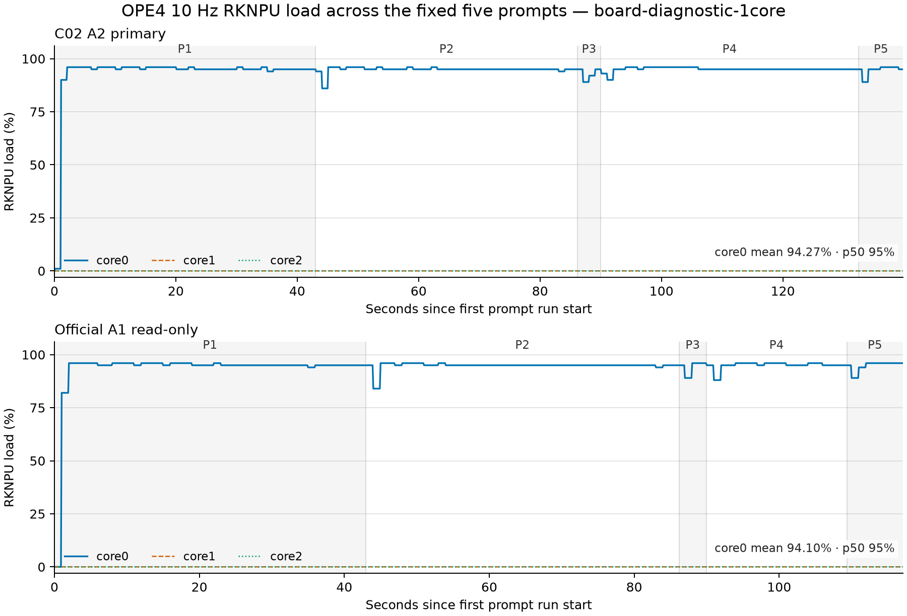

# OPE4 双载体层级归因报告（board-diagnostic-1core）

状态：`VALID_OPE4_SINGLE_SEGMENT_OWNER_WAIVER_MODEL_STAGE_ANCHOR_PRESENT`。本次依 owner 指令只执行一个正式段；复测门为 `WAIVED_BY_OWNER_NOT_SATISFIED`，不得声称 OPE4 replication。

## 第一层：负载、载体与执行有效性

五条 prompt 从 M0 S2a 证据包重新提取并以新的 OPE4 manifest 冻结。两载体均使用同一 manual Gemma4 模板、top-k=1、96 个最大新 token、16K context、单轮无历史；C02 是主载体，官方冻结件只读对照。没有执行质量评测，也没有检查回答语义。

- 总有效性：`PASS`；governor 成对恢复：`True`。
- transcript 门：严格 UTF-8、非空、无 `[PAD]`、无替换字符；结果 `PASS`。
- OPE3 保留：isolated measurement=`True`，Tier-B 原冻结代理=`False`；OPE4 不回写该负结果。

## 第二层：同协议 C02 vs 官方对照

| carrier lineage | TTFT p50 (ms) | callback TPOT aggregate (ms/token) | RKLLM perf decode (ms/token) | NPU core0 mean / p50 / max (%) | CPU cores utilized |
|---|---:|---:|---:|---:|---:|
| C02 A2 primary | 640.625 | 446.126 | 445.909 | 94.267 / 95.000 / 96.000 | 0.607 |
| official A1 read-only | 646.375 | 446.240 | 446.022 | 94.097 / 95.000 / 96.000 | 0.609 |

callback TPOT 的主口径是所有 prompt 内相邻 NORMAL callback 间隔的加权聚合；WAITING 事件保留在原始 CSV，但不进入 token 间隔。RKLLM perf 列是 runtime 字段的独立交叉。载体间差异仅用于系统诊断，不代表训练质量。

C02 相对官方：TTFT p50 比值 `0.9911`，callback TPOT 比值 `0.9997`。

### RKLLM 阶段拆分

| carrier | init (ms) | prompt wall p50 (ms) | prefill p50 (ms) | generate p50 (ms) | generated tokens total | wall−prefill−generate p50 (ms) | memory max (MiB) |
|---|---:|---:|---:|---:|---:|---:|---:|
| C02 A2 primary | 16050.983 | 42546.223 | 639.439 | 41880.246 | 306 | 22.297 | 5861.160 |
| official A1 read-only | 16087.727 | 19381.063 | 645.186 | 18725.207 | 255 | 10.410 | 5861.523 |

`wall−prefill−generate` 只描述 callback/runtime 侧剩余时间，不命名为 SDK 未公开阶段。两载体因 EOS 位置不同而生成 token 总数不同，绝对 generate/prompt wall 时长不能当作速度对比；归一化比较使用上表 TPOT。两载体的 callback interval 数均与 RKLLM `generate_tokens` 总数一致，callback 与 runtime 的 decode ms/token 相对差均小于 0.1%。

## 第三层：OPE1 权重流量 × OPE0 带宽锚

| 帐本 | 权重流量 (B/token) | OPE0 下界预测 (ms/token) | C02 callback 实测 (ms/token) | gap |
|---|---:|---:|---:|---:|
| 258 次核心投影（不是全部 linear） | 3,890,216,960 | 167.717 | 446.126 | 166.000% |
| 全部 343 个非 lm_head linear | 3,972,792,320 | 171.277 | 446.126 | 160.471% |

这里的 `predicted = 权重流量 / OPE0 CPU triad ceiling` 只是解析帐下界，不是 NPU DRAM 计数器实测。NPU 内部 SRAM 复用、权重压缩与调度气泡仍是候选；本次证据只能用 NPU load 曲线和进程级 CPU perf 判断兼容性，不能强行锁定单一原因。

归因裁决：实测高于两列解析下界；prompt 窗口内 NPU core0 mean/p50=94.267%/95.000%，10 Hz 尺度呈持续近满载，不支持把主要差额归为百毫秒级粗粒度调度空洞（更细气泡仍不可见）。进程级 CPU 参与约 0.607 核，未显示 4 个可用 A76 饱和。结合 OPE2 已记录的 M=1 同几何强路径瓶颈，NPU/runtime decode 路径限制与现象相容；现有接口没有 NPU DRAM 字节计数器，SRAM 复用和权重压缩均不能证实或排除。

## 结论边界

OPE4 模型阶段锚已按单段 owner waiver 处理。OPE3 的 Tier-B `bus_access×64B` 代理仍为 FAIL，因此即便本阶段锚定有效，K-E1 四门也不会被改写成全 PASS。所有数字仅为 `board-diagnostic-1core`，不外推 3-core、不与 B0/PC 同表、不形成部署或质量声明。
